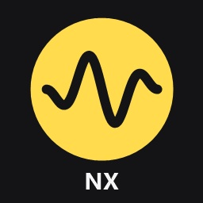

# 🎵 YaMu-nx — Яндекс Музыка для Nintendo Switch

Неофициальный homebrew-клиент **Яндекс Музыки** для **Nintendo Switch** с Atmosphère. Работает без телефона, умеет скачивать музыку и играет **поверх игр** — через фоновый модуль и оверлей Tesla / Ultrahand.



*Unofficial Yandex Music client for the Nintendo Switch (Atmosphère homebrew): standalone app with search, lyrics and offline downloads, plus a background sysmodule and a Tesla overlay to keep music playing in games.*

> ⚠️ Проект не связан с Яндексом и не одобрен им. Он использует неофициальное API, которое может измениться в любой момент. Нужна **ваша собственная подписка Яндекс Плюс**. Скачанные треки — только для личного прослушивания.

---

## 🌟 Возможности

### 📱 Приложение

- 🌊 **Моя волна**: бесконечный поток под ваш вкус и станции «Бодрое», «Спокойное» и «Незнакомое». Лайки и пропуски учитываются в рекомендациях.
- 📚 **Моя музыка**: «Мне нравится» (все треки, без ограничений), ваши плейлисты, «Мои альбомы» и закладки любимых плейлистов прямо на главном экране.
- 🔍 **Поиск**: треки, исполнители, альбомы и плейлисты — как в Яндекс Музыке. Своя экранная клавиатура с **русской и английской** раскладкой.
- 👤 **Исполнители и альбомы**: популярные треки, «Альбомы», «Синглы и EP», «С участием» и похожие исполнители. Ряды листаются свайпом.
- 🎤 **Тексты песен**: с подсветкой текущей строки. Тап по строке — перемотка к ней.
- 🎶 **Плеер**: mp3 до 320 kbps и AAC, плавные переходы между треками, перемешивание и повтор, своя громкость. Тап по исполнителю открывает его страницу, по названию — альбом.
- 💾 **Скачанное**: треки и целые плейлисты на SD-карту — слушайте без интернета.
- 📲 **Управление с телефона**: Свич виден в приложении Яндекс Музыки как устройство, переключайте треки с телефона.
- 🔑 **Вход по коду**: приложение покажет код, введите его на `ya.ru/device`. Токен не нужен.
- 🎨 **Оформление**: тёмная, чёрная (OLED) и светлая тема, готовые цвета акцента или свой, фон плеера из обложки, крупный текст, настраиваемые плитки главного экрана.
- 🎮 **Геймпад и тач**: всё управляется кнопками, а списки и полосы — пальцем.

### 🎧 Музыка поверх игр

- 🔁 **Фоновый модуль**: выходите из приложения кнопкой HOME или «+» — трек продолжится с того же места. Откроете приложение снова — оно заберёт музыку обратно.
- 🧩 **Оверлей для Tesla / Ultrahand**: что играет, перемотка, пауза, назад, дальше, лайк, перемешивание и громкость. Отсюда же — «Моя волна», плейлисты и «Скачанное».
- ⚙️ **Свои настройки оверлея**: тема и акцент (общие с приложением), какие блоки показывать, компактный вид.
- 📴 **Без сети**: скачанные треки играют и в фоне.

---

## 📦 Установка

1. Скачайте `YaMu-nx-v*.zip` из [Releases](../../releases).
2. Скопируйте папки `switch` и `atmosphere` из архива в корень SD-карты:
   ```
   switch/yamu-nx/yamu-nx.nro                        приложение
   switch/.overlays/yamu-nx.ovl                      оверлей
   atmosphere/contents/4200000000594D53/exefs.nsp    фоновый модуль
   atmosphere/contents/4200000000594D53/toolbox.json чтобы модуль был виден в ovlSysmodules
   ```
3. Запустите **YaMu-nx** из Homebrew Menu в **полном режиме**: удерживая **[R]** при запуске любой игры, а не через альбом.

> 💡 **Совет:** для музыки поверх игр нужно меню оверлеев **Tesla** или **Ultrahand** с nx-ovlloader. Фоновый модуль запускается сам; автозапуск вместе с консолью включается в **ovlSysmodules**.

---

## 🔑 Вход в аккаунт

### Способ 1: По коду (проще всего)
1. Запустите приложение — на экране появится код.
2. Откройте на телефоне или компьютере `ya.ru/device` и введите его.
3. Готово: приложение войдёт само.

### Способ 2: Токеном
1. Откройте в браузере и войдите в Яндекс:
   ```
   https://oauth.yandex.ru/authorize?response_type=token&client_id=23cabbbdc6cd418abb4b39c32c41195d
   ```
   (это ID официального Android-приложения, его же использует [yandex-music-api](https://github.com/MarshalX/yandex-music-api)).
2. Из адреса, куда вас перекинет, скопируйте часть между `access_token=` и первым `&`.
3. Сохраните её одной строкой в `switch/yamu-nx/token.txt`.

> 🔒 **Никому не показывайте токен** — с ним можно войти в ваш аккаунт. Отозвать: id.yandex.ru → «Безопасность» → «Выйти на всех устройствах».

---

## 🎮 Управление

| Кнопка | Плеер | Списки | Главная |
| --- | --- | --- | --- |
| **[A]** | Пауза / играть | Играть | Открыть |
| **[B]** | Назад | Назад | — |
| **[L] / [R]** | Предыдущий / следующий трек ¹ | то же | — |
| **← →** | Перемотка ¹ | — | Выбор плитки |
| **↑ ↓** | Перемешивание / повтор | Листать | Выбор плитки |
| **Правый стик ↑ ↓** | Громкость | — | — |
| **[Y]** | Текст песни | Перемешать | — |
| **[ZR]** | Лайк | Лайк играющему треку | то же |
| **[ZL]** | Скачать трек | Скачать всё | — |
| **[−]** | Поиск | Поиск (в «Скачанном» — удалить) | Поиск |
| **[X]** | Главная | Главная | Плеер |
| **[+]** | Выход, музыка уйдёт в фон | то же | то же |

¹ В настройках можно поменять местами: перемотка на **[L] / [R]**, треки на стрелках.

**Клавиатура поиска:** **[A]** — ввести, **[B]** — стереть, **[X]** — пробел, **[Y]** — русская / английская раскладка, **[+]** — найти, **[−]** — закрыть.

> 👆 Почти всё работает и тачем: тап — нажать, свайп — листать, по полосе прогресса — перемотка.

---

## 🛠 Сборка из исходников

### Требования
- **devkitPro** с пакетом `switch-dev`
- Библиотеки (через `dkp-pacman`):
```bash
dkp-pacman -S switch-dev \
              switch-sdl2 \
              switch-sdl2_ttf \
              switch-sdl2_image \
              switch-ffmpeg \
              switch-curl \
              switch-mbedtls \
              switch-mpg123
```

> ⚠️ Путь к папке проекта должен быть **латиницей**: компоновщик devkitPro не понимает кириллицу в путях.

### Команды сборки
```bash
make                 # приложение → yamu-nx.nro
make -C sysmodule    # фоновый модуль → sysmodule/yamu-sys.nsp (кладётся как exefs.nsp)
make -C overlay      # оверлей → overlay/yamu-nx-ovl.nro, переименовать в yamu-nx.ovl
```

### Заливка на консоль
По MTP (DBI → «Run MTP responder»), со сверкой MD5:
```bash
powershell -ExecutionPolicy Bypass -File tools\switch-deploy.ps1            # всё
powershell -ExecutionPolicy Bypass -File tools\switch-deploy.ps1 app ovl    # выборочно: app, ovl, sys
```
Прежние версии с консоли скрипт уносит в `backups/`, на карте копий не остаётся.

---

## 🧱 Устройство

```
common/      общий код: HTTP (curl), JSON, клиент API Яндекс Музыки, журнал аварий
source/      приложение: интерфейс (SDL2), плеер (FFmpeg → audout), фоновые задачи, офлайн, управление с телефона
sysmodule/   фоновый модуль: плеер mp3/AAC (mpg123, FAAD2), очередь, TCP-команды на 127.0.0.1:47123
overlay/     оверлей Tesla (libtesla в overlay/lib)
tools/       заливка на консоль по MTP
```

Приложение, модуль и оверлей общаются текстовыми командами по локальному TCP
(`STATUS`, `TOGGLE`, `NEXT`, `PREV`, `LIKE`, `WAVE`, `LIBRARY`, `PLAYLIST`, `OFFLINE`, `VOLUME`, `SEEK`, `HANDOFF`, `RELEASE`, `EXIT` и др.).
При передаче музыки состояние (очередь, трек, позиция) пишется в `switch/yamu-nx/handoff.json`.

---

## 🐞 Если что-то не так

Пришлите журналы в [Issues](../../issues):
- 📄 `switch/yamu-nx/app.log` — приложение: почему закрылось, сколько памяти было занято
- 📄 `switch/yamu-nx/sys.log` — фоновый модуль (в том числе нехватка памяти и аварии)

---

## 🙏 Благодарности

- [MarshalX/yandex-music-api](https://github.com/MarshalX/yandex-music-api) — описание API и подписи запросов
- [WerWolv/libtesla](https://github.com/WerWolv/libtesla) — библиотека оверлеев (GPL-2.0), включает stb_truetype
- [HookedBehemoth/sys-tune](https://github.com/HookedBehemoth/sys-tune) — пример описания фонового модуля
- [knik0/faad2](https://github.com/knik0/faad2) — декодер AAC в фоновом модуле (GPL-2.0)
- [devkitPro](https://devkitpro.org), libnx, FFmpeg, mpg123, curl, SDL2

## 📜 Лицензия

[GPL-2.0](LICENSE) — оверлей построен на libtesla, а модуль на FAAD2, обе под этой лицензией.
